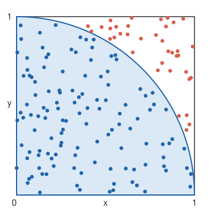

## Today's path — 15 minutes {#path}

:::{.nonincremental}
1. The running example: **Monte-Carlo π**.
2. Read its loop: `end`, ranges from **1**, the **dot**, **macros**.
3. One cheat-sheet to keep open.
:::

. . .

> **You can** read a Julia loop: what goes in, what comes out. No performance yet.

. . .

> After the cheat-sheet: [**reference**](#reference) slides, not projected.

::: {.notes}
Session 1, minutes 10–25. Project only the slides up to the cheat-sheet. Julia is the test
bench of the demos; the activities are in Python, so nobody needs to write Julia today.
Script: ../scripts/0_julia_basics.jl · Notebook: ../pluto/0_julia_basics.jl (linked on the last core slide).
:::

# The running example {style="text-align: center;"}

## Monte-Carlo π: the idea {#pi-idea}

:::: {.columns}
::: {.column width="42%"}
{width="100%"}
:::
::: {.column width="58%"}
- Draw `n` points in the unit square.
- **Count** those with `x² + y² ≤ 1`.
- Quarter disk: area **π/4**, so

::: {.fragment}
$$\pi \approx 4 \times \frac{\text{hits}}{n}$$
:::

::: {.fragment}
> Here: 123 hits out of 160 → 3.075.
:::
:::
::::

::: {.notes}
Four words to fix now, reused in every module: points, indicator (inside or not), count, estimator.
The count is the expensive part and the only part we will ever parallelize.
:::

## The loop we will meet again and again

. . .

```julia
function count_in_disk(n)
    hits = 0
    for _ in 1:n
        x, y = rand(), rand()
        if x^2 + y^2 ≤ 1
            hits += 1
        end
    end
    return hits
end
4 * count_in_disk(100_000) / 100_000       # ≈ 3.14
```

. . .

> What goes in, what comes out, what looks new? ▶ Script: cell "1. Monte-Carlo π"

::: {.notes}
Let them list the oddities: `end`, `1:n`, `^`, `≤`, `100_000`, no colon, no indentation rule.
The next three slides answer exactly that list. Same function in every module: timed (1),
split over threads (3), on the GPU (5).
:::

# Reading it {style="text-align: center;"}

## Blocks close with `end`

. . .

```julia
function area_rect(L, w)      # long form
    return L * w
end
square(x) = x^2               # one-line form

for i in 1:3
    println(i)
end                           # ← closes the loop
```

- Every block is closed by **`end`**. No `:`; indentation is for readers.
- Power is [`^`]{style="background-color: yellow;"}: `2**10` is a syntax error.

. . .

> ▶ Script: cells "2. Reading it — Blocks close with `end`" and "Functions, three forms"

::: {.notes}
`return` is optional: the last expression is returned. `≤` is typed `\le` then TAB; `<=` works too.
`_` is a loop variable we never read. `100_000` is just 100000.
:::

## Ranges and indices start at 1

. . .

```julia
v = [10, 20, 30, 40, 50]
v[1]        # 10  (v[0]: error)
v[end]      # 50
v[2:4]      # [20, 30, 40]
1:5         # 1, 2, 3, 4, 5
```

. . .

| | Python | Julia |
|---|---|---|
| First | `v[0]` | [`v[1]`]{style="background-color: yellow;"} |
| Last | `v[-1]` | `v[end]` |
| `2:4` | 2, 3 | 2, 3, **4** |

. . .

> ▶ Script: cell "Arrays: 1-based, slices include both ends" — try `v[0]`.

::: {.notes}
`for _ in 1:n` runs n times: both ends are included.
:::

## Element by element: the dot

. . .

```julia
xs = [1.0, 4.0, 9.0]
sqrt.(xs)       # [1.0, 2.0, 3.0]
xs .+ 1         # [2.0, 5.0, 10.0]
square.(xs)     # works on YOUR functions too
```

- `sqrt(xs)`, without the dot?
- `f.(x)` is what `np.f(x)` does in NumPy.

. . .

> ▶ Script: cell "Broadcasting — the dot" — try `sqrt(xs)`.

::: {.notes}
`sqrt(xs)` is a `MethodError`: `sqrt` takes a number. The dot says "element by element".
We need it for the GPU version of π: `x.^2 .+ y.^2 .<= 1`.
:::

## Macros start with `@`

. . .

```julia
@time count_in_disk(10^7)     # run it, and print how long it took
```

- A macro **rewrites the code that follows it**.
- Coming: `@time`, `@btime` (measure) · `@async`, `@sync`, `@spawn` (tasks).

. . .

> ▶ Script: cell "Macros start with @"

::: {.notes}
No need to write macros. Python analogy: a decorator such as `@njit`, but applied to any
expression, not only to a function definition.
:::

## Cheat-sheet — Python → Julia {.smaller}

| Topic | Python | Julia |
|---|---|---|
| First / last | `v[0]` / `v[-1]` | `v[1]` / `v[end]` |
| Slice | `v[1:4]` excl. 4 | `v[2:4]` **incl.** 4 |
| Blocks / else-if | `:` + indent / `elif` | **`end`** / `elseif` |
| Power / int-div | `2**10` / `//` | `2^10` / `÷` |
| Concat / f-string | `"a"+"b"` / `f"{x}"` | `"a"*"b"` / `"$x"` |
| Element-wise | `np.f(x)` | `f.(x)` |
| Method call | `obj.method()` | `method(obj)` |
| Class | `class C` + `self` | `struct C` |
| Copy vs alias | `b = a` aliases; `a.copy()` | `b = a` aliases; `copy(a)` |
| Absent value | `None` | `nothing` / `missing` |

## You can now read the loop

:::{.nonincremental}
- Input `n`, output a **count**; estimate `4 * count / n`.
- `end` closes blocks · ranges include both ends.
- The dot is element-wise · `@…` is a macro.
:::

. . .

> ▶ [Script](../scripts/0_julia_basics.jl) · [Notebook](../pluto/0_julia_basics.jl) · ⬅ [Overview](course.qmd)

. . .

> **Next:** the same loop, **timed** — [1 — Interpreted vs compiled](1_compilation_and_types.qmd) ➡

# Reference — not projected {#reference style="text-align: center;"}

## Variables & types

. . .

```julia
x = 3            # Int64
y = 2.5          # Float64
name = "Ada"     # String
```

. . .

> Assign with `=`, no declaration. `typeof(x)` = Python's `type(x)`.

. . .

> ▶ Script: cell "3. Reference — Variables & types"

## Numbers and Unicode

. . .

```julia
10 / 4      # 2.5  (true division)
10 ÷ 4      # 2    (\div TAB; Python // for these positive values)
10 % 4      # 2
α = 0.1     # \alpha TAB
2 ∈ [1, 2, 3]        # \in
2π          # 2 * π
```

. . .

> `2α` is `2 * α`: formulas map straight to code.

. . .

> ▶ Script: cells "Numbers" and "Unicode & juxtaposition"

## Strings

. . .

```julia
a, b = 3, 4
"Hello, $name"          # "Hello, Ada"
"$a + $b = $(a + b)"    # "3 + 4 = 7"
"foo" * "bar"           # "foobar"
'a'                     # a Char
```

- `$` = f-string. Concatenation is [`*`]{style="background-color: yellow;"}: `"foo" + "bar"` is a `MethodError`.
- `"…"` text; `'…'` **one** character.

. . .

> ▶ Script: cell "Strings".

## Ranges, comprehensions, matrices

. . .

```julia
1:2:9                           # 1, 3, 5, 7, 9
[i^2 for i in 1:5]              # [1, 4, 9, 16, 25]
[i for i in 1:10 if iseven(i)]  # [2, 4, 6, 8, 10]
M = [1 2 3; 4 5 6]              # 2×3 matrix
M[2, 3]                         # 6
```

- Ranges are **lazy**; `collect(1:2:9)` builds the array.
- Matrices are stored **column by column** (NumPy's default is row by row): see the memory module.

::: {.notes}
In a matrix literal, spaces separate columns, `;` starts a new row.
:::

## Tuples, named tuples, dicts

. . .

```julia
t = (1, "two", 3.0)
p, q, s = t                  # q == "two"
t[1]                         # 1

nt = (x = 10, y = 20)
nt.x                         # 10

d = Dict("apple" => 3, "pear" => 5)
d["apple"]                   # 3
haskey(d, "pear")            # "pear" in d
```

## Conditionals

. . .

```julia
x = 11
if x ≥ 16
    "excellent"
elseif x ≥ 10
    "pass"
else
    "fail"
end                    # "pass"

x ≥ 0 ? "pos" : "neg"  # ternary
```

. . .

> [`elseif`]{style="background-color: yellow;"}, one word. `c ? a : b` = Python's `a if c else b`.

## Loops

. . .

```julia
words = ["a", "b"]
for (i, w) in enumerate(words)
    println(i, " ", w)
end

[(i, w) for (i, w) in enumerate(words)]  # [(1, "a"), (2, "b")]
```

- `for … end`, comprehensions: as in Python.
- `enumerate` counts from **1**.

## `let … end`: a local scope

. . .

```julia
v = [10, 20, 30, 40, 50]
let
    acc = zero(eltype(v))      # 0 of v's type
    for i in eachindex(v)      # 1:5
        acc += v[i]
    end
    acc                        # → 150
end
```

. . .

> Variables inside stay local, as in a function. Later scripts time code inside `let`.

::: {.notes}
`zero(eltype(v))` and `eachindex(v)` work for any array: later modules use them. The last expression is the block's value.
:::

## More on functions

. . .

```julia
cube = x -> x^3                              # lambda

greet(who; punct = "!") = "Hi $who$punct"    # kwarg after ;
greet("Bob"; punct = "?")                    # "Hi Bob?"

@. xs^2 + 1                                  # dot on EVERY op
```

- Trailing **`!`** (`push!`, `sort!`): modifies its argument (convention).
- Chained dots **fuse into one loop**: no temporary arrays.

## Structs, not classes

. . .

```julia
struct Point            # immutable
    x::Float64
    y::Float64
end

mutable struct Counter; n::Int; end

pt = Point(1.0, 2.0)    # no __init__
c = Counter(0); c.n += 1  # fine
# pt.x = 5.0            # ERROR
```

- No `self`: behavior lives in **functions** (dispatch module).

. . .

> ▶ Script: cell "Structs instead of classes" — try `pt.x = 5.0`.

::: {.notes}
Changing a struct's fields later needs a REPL restart.
:::

## Packages

. . .

```julia
using Statistics           # stdlib: just load

using Pkg
Pkg.add("BenchmarkTools")  # once (pip install)
using BenchmarkTools       # import
```

. . .

> `using` ≈ `from numpy import *`.

. . .

> ▶ Script: cell "Packages" · ⬅ [Back to the path](#path)
