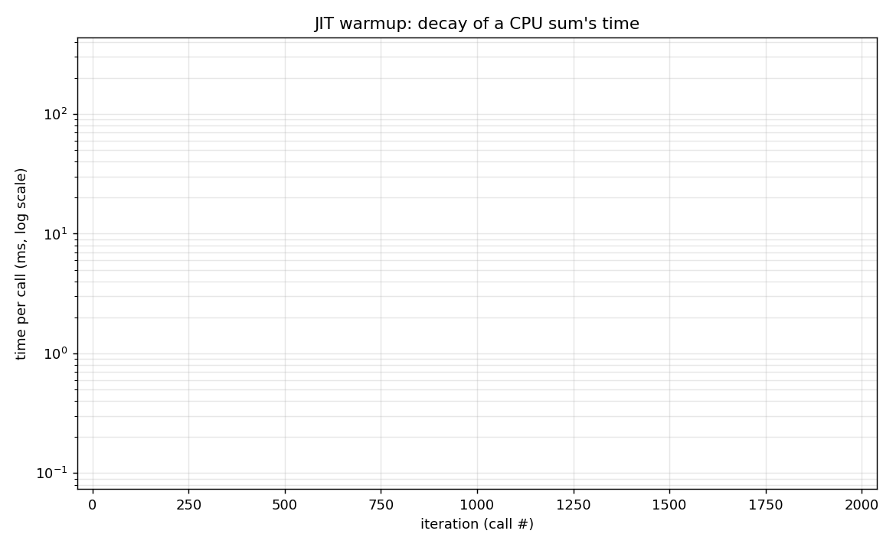
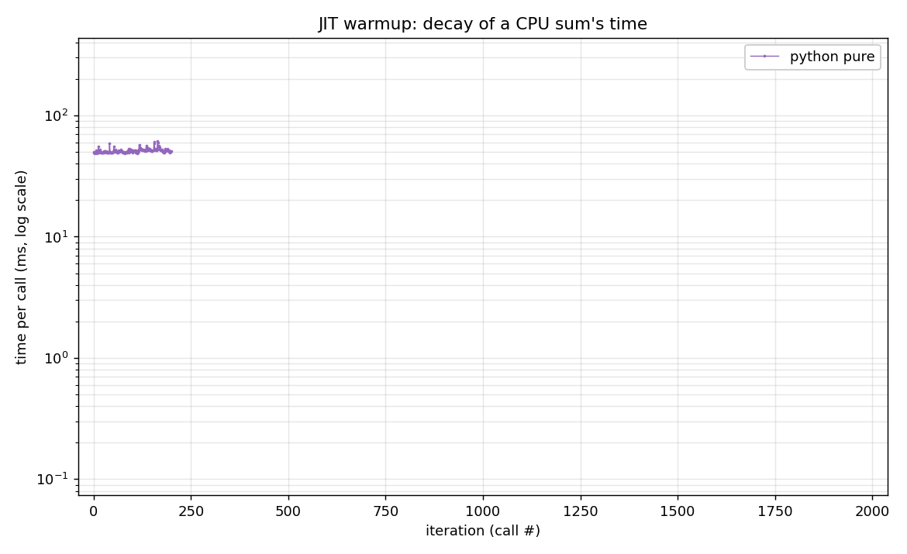
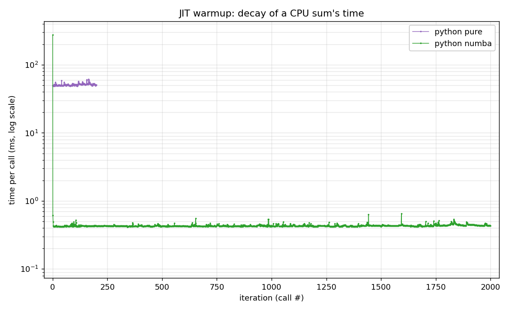
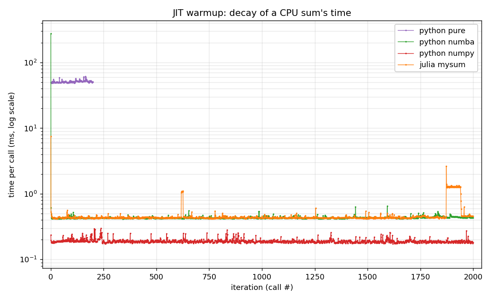
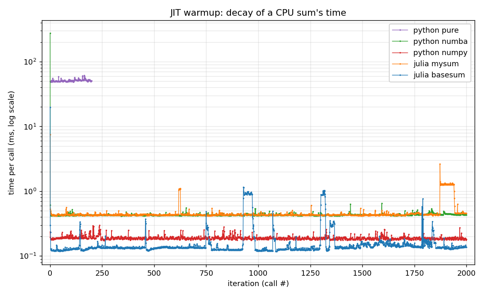

## Measure, verify, choose {#path}

:::{.nonincremental}
1. Explain **first-call and warmed-up times**. [Loop activity](#a1)
2. Record a **measurement protocol** and check the result.
3. Choose a block using **whole-program speedup**. [Diagnostic activity](#a2)
:::

. . .

[Script](../scripts/1_compilation_and_types.jl) · [Julia notebook](../pluto/1_compilation_and_types.jl) · [Python notebook](../python/1_compilation_and_types_python.ipynb)

. . .

[Previous: Julia syntax](0_julia_basics.qmd) · Optional: [compiler](#appendix-compiler), [SIMD](#appendix-simd)

::: {.notes}
Session 1, minutes 25–140. The first activity precedes all curves and reference times.
Do not run the whole script before students predict. It contains demonstrations, not the activity.
The appendices are optional and are not required for either activity or the project.
:::

## The loop to compare

. . .

```julia
function mysum(x)
    s = zero(eltype(x))      # 0.0 for Float64 input
    for i in eachindex(x)   # all valid indices
        s += x[i]
    end
    return s
end
```

. . .

> Same sum of **10⁶ Float64 values**: how does execution time depend on the implementation?

::: {.notes}
▶ Script: cell "1. A hand-written sum". Do not reveal the timings yet.
The activity uses the same array values as a Python list for the interpreted loop and as a
NumPy array for NumPy and Numba. This is an implementation comparison, not compilation alone.
:::

## The comparison protocol

- **Five reference variants:** Python loop, NumPy, Numba; Julia loop, Julia `sum`.
- **Input:** 10⁶ Float64 values, generated before timing.
- **Two measurements:** first call, then warmed-up calls on the same machine.

. . .

> Predict the ordering and the first-call effect **before running**.

::: {.notes}
The class activity runs three Python variants or two Julia variants; the instructor's curves
compare all five. Reference experiment: elapsed time for each call, 2000 calls for fast variants,
200 for pure Python, on the course laptop. No input generation inside the timer.
The historical figure does not archive complete hardware/software metadata; its rounded plateaus
are illustrative, not benchmark targets or a hardware ranking. Record the environment for your run.
:::

## ✏️ What does a loop cost? {#a1}

:::{.nonincremental}
- **Question:** same sum: Python loop, `numpy`, `numba`. How far apart? What does the first call cost?
- **Predict:** your ranking and one speedup, **before** running.
- **Do:** fill the two functions, check the assertion.
- **Write down:** first call · warmed-up times · speedups · one sentence explaining the gap.
:::

. . .

> 🐍 [Python (Colab)](https://colab.research.google.com/github/epilliat/epilliat.github.io/blob/master/docs/teaching/parallel_computing/activities/release/1_warmup_python_todo.ipynb) · [local .py](../activities/release/1_warmup_python_todo.py) · [Julia](../activities/release/1_warmup_julia_todo.jl) · **20 min**

::: {.notes}
Python is the common track; the Julia file is the same task for volunteers.
Walk around: the usual blocker is `range(x.shape[0])` inside numba, not the idea.
:::

## First call and subsequent calls

. . .

::: {.r-stack}
{width="82%"}

{.fragment width="82%"}

{.fragment width="82%"}

{.fragment width="82%"}

{.fragment width="82%"}

{.fragment width="82%"}

{.fragment width="82%"}
:::


## Debrief: first call and warmed-up calls {#a1-debrief}

. . .

Course laptop, **10⁶ Float64 values**: per-call elapsed times (rounded).

| Variant | First call | Warmed-up median |
|---|---|---|
| Python loop | 49.7 ms | 51.2 ms |
| NumPy | 0.236 ms | 0.186 ms |
| Numba | 274 ms | 0.443 ms |
| Julia loop | 7.47 ms | 0.458 ms |
| Julia `sum` | 19.9 ms | 0.136 ms |

. . .

> Compare your results. Which variants have a first-call cost? Which warmed-up speedups differ?

::: {.notes}
Warmed-up median = median of the last 10% of calls. Values recomputed from the existing
experiences/warmup_jit/results/warmup_*.csv traces; no new benchmark run.
2000 calls per fast variant; 200 for pure Python. The first-call column is the first sample.
Do not compare class-machine times with the reference as evidence of a language effect.
A compilation effect is compatible with the initial spikes; CPU/cache warmup also affects timings.
:::

## Where does the loop run?

. . .

| Approach | Loop execution | Compilation |
|---|---|---|
| Python `for` | Interpreter | No native compilation of this loop |
| NumPy | Compiled library | Before execution |
| Numba / Julia | Compiled code | First call for the argument types, if needed |

. . .

> NumPy provides compiled operations; **Julia and Numba also compile your own loops**.

::: {.notes}
One explanation after the experiment. A Python loop over a NumPy array still executes in the
interpreter. CPython also specializes interpreter instructions; that does not compile this
whole loop to native code. Julia specializations may already be available; not every first call
must compile. Type-specific machine instructions are in the compiler appendix.
:::

# Measuring execution time {style="text-align: center;"}

## Pitfall 1: including compilation without saying so

. . .

```julia
g(x) = sum(abs2, x)
@time g(v)   # first call: may include compilation
@time g(v)   # warmed-up call
```

. . .

> Report the **first call separately** from warmed-up calls.

::: {.notes}
▶ Script: cell "2. Measuring properly". For a one-shot script, compilation is part of user-visible
runtime. It is not noise to discard without stating the scope. The first call can also include
library initialization, allocation and cache effects.
:::

## Pitfall 2: relying on one measurement

. . .

```julia
@btime     mysum($v)   # minimum across repeated measurements
@benchmark mysum($v)   # distribution
```

- Record warmup, repetitions and the **reported statistic**.
- `$v` supplies the input value to the Julia benchmark.
- Python: `timeit`, or repeated `perf_counter` measurements.

::: {.notes}
▶ Script: cell "Read the timing distribution". The minimum approximates a low-interference
execution time; the median describes a typical observation. Report which one you use.
BenchmarkTools performs warmup and repeated evaluations; explain globals in the dispatch module.
:::

## Record the measurement protocol {#card}

. . .

| Field | Record |
|---|---|
| **Correctness** | Check and tolerance |
| **Input** | Size and element type |
| **Environment** | Hardware, software versions, workers/threads |
| **Protocol** | Warmup, repetitions, reported statistic |
| **Timed scope** | Included and excluded costs |

. . .

> Use the **same machine** to compare implementations.

::: {.notes}
The stable #card anchor is reused by activities throughout the course. Threads include BLAS
threads as well as workers. Record dependencies/versions. Common scope differences: generation,
compilation, pool startup and transfers. Record both the result check and the timing protocol.
:::

# Checking the result {style="text-align: center;"}

## Measuring the π estimator

. . .

```julia
estimate_pi(n) = 4 * count_in_disk(n) / n
```

1. How long does `estimate_pi(1_000_000)` take after warmup?
2. How can we check a result that changes between runs?

::: {.notes}
▶ Script: cells "3. Monte-Carlo π" and "Timing the estimator".
Type inference, allocations and preparation for parallelism are not additional questions here.
We focus on timing scope and correctness. The following slide separates two kinds of checks.
:::

## Two complementary checks

- **Counting logic:** fixed points with a known count.
- **Estimator:** error consistent with its standard error, approximately $1.64/\sqrt{n}$.

. . .

```julia
x = [0.0, 0.5, 1.0, 1.0]
y = [0.0, 0.5, 0.0, 1.0]
# Three points satisfy x² + y² ≤ 1.
```

. . .

> A statistical tolerance complements the code check; it does **not replace it**.

::: {.notes}
▶ Script: cells "Check the counting logic" and "Check the estimator".
Use the same inside_disk predicate in the random loop and the fixed-point check.
With p = π/4, SE = 4 sqrt(p(1−p)/n). At n = 10⁶ it is about 0.00164.
A single error can increase as n increases. A check at several standard errors can occasionally
fail for a correct estimator, and passing it does not establish correctness.
A fixed seed supports repeatability; an independently known count supports correctness.
:::

# Which block should we optimize? {style="text-align: center;"}

## Local speedup and whole-program speedup {#amdahl}

. . .

A block takes a fraction $f$ of the time and becomes $s$ times faster:

$$\text{whole-program speedup} = \frac{1}{(1-f) + f/s}$$

Which change helps more?

- **A:** 10% of the time, **10×** faster.
- **B:** 80% of the time, **2×** faster.

::: {.notes}
Assume unchanged work and unchanged costs outside the block. A: 1.10×; B: 1.67×.
Even an instantaneous A gives at most 1.11×. Reveal answers in the diagnostic debrief.
The same model is used later for parallel work in Amdahl's law.
:::

## ✏️ Diagnose before optimizing {#a2}

:::{.nonincremental}
- **Question:** which stage should we optimize?
- **Predict:** the whole-program speedup from the baseline timings.
- **Do:** implement, check the output, then measure.
- **Write down:** stage times · local/overall speedups · [protocol](#card).
:::

. . .

> 🐍 [Python (Colab)](https://colab.research.google.com/github/epilliat/epilliat.github.io/blob/master/docs/teaching/parallel_computing/activities/release/1_diagnostic_python_todo.ipynb) · [local .py](../activities/release/1_diagnostic_python_todo.py) · **20 min**

::: {.notes}
Three minutes to inspect the baseline and write the prediction.
Coarse timing around stages is sufficient; this does not reintroduce profiling.
The notebook supplies a vectorized candidate; choosing the target must be justified from timings.
:::

## Debrief: local and overall speedups {#a2-debrief}

- Compare the **predicted and observed** whole-program speedups.
- Explain the A/B example: **1.10×** versus **1.67×**.
- Identify the next stage to investigate **after** the change.

. . .

> Report speedup on the **block** and on the **whole program**.

::: {.notes}
The dominant stage may change. Differences from the model can come from measurement noise,
allocation, changed data movement or work shifted to another stage.
:::

## Four rules for reliable comparisons

:::{.nonincremental}
1. Distinguish **first-call and warmed-up times**.
2. Report the **measurement protocol**.
3. Check the **code** and the **statistical result**.
4. Measure **whole-program speedup**, not only the block.
:::

. . .

> **Next:** [Multiple dispatch](2_dispatch_vs_oop.qmd) · [Reference experiment](https://github.com/epilliat/epilliat.github.io/tree/master/teaching/parallel_computing/experiences/warmup_jit)

# Optional — type specialization {#appendix-compiler style="text-align: center;"}

## Specialization by argument types

. . .

| Arguments | Machine operation for `x + y` |
|---|---|
| `Int, Int` | Integer addition |
| `Float64, Float64` | Floating-point addition |
| `Float64, Int` | Conversion, then floating-point addition |

. . .

> A compiled specialization can resolve operations using the **argument types**.

## Watching the compiler

. . .

```julia
f(x) = 2x + 1

@code_lowered f(3.0)   # desugared
@code_typed   f(3.0)   # types inferred
@code_native  f(3.0)   # assembly
```

. . .

> Try `f(3.0)` **and** `f(3)`. What changes?

. . .

> ▶ Script: cells "4. Optional — type specialization" to "Step 3, with an Int"

## Same `f`, two compilations {.smaller}

. . .

:::: {.columns}
::: {.column width="48%"}
`f(3.0)` — `Float64`

```
mul_float(2.0, x)
add_float(%1, 1.0)
```

```asm
vaddsd  xmm0, xmm0, xmm0
vaddsd  xmm0, xmm0, [1.0]
```
:::
::: {.column width="48%"}
`f(3)` — `Int`

```
mul_int(2, x)
add_int(%1, 1)
```

```asm
lea     rax, [2*rdi + 1]
```
:::
::::

- One line, **two native functions**
- No type check: types **known at compile time**
- Not known? **Type instability**, with dispatch


## Inspecting the π estimator's types

. . .

```julia
@code_warntype count_in_disk(1000)
Base.return_types(estimate_pi, (Int,))
```

. . .

> Which types are inferred? The dispatch module examines the cost of unknown types.

::: {.notes}
▶ Script: cell "Optional — inspect the estimator's types".
Do not treat every colored union as a performance problem; iterator-related unions can be harmless.
:::

# Optional — SIMD reductions {#appendix-simd style="text-align: center;"}

## Why is `sum` faster?

. . .

Separate reference experiment: **10⁵ Float64 values**, warmed-up timings:

| Implementation | Time per call |
|---|---|
| `mysum` | 44 µs |
| Base `sum` | 7.5 µs |

. . .

> Which instructions and how many accumulators does each reduction use?

::: {.notes}
▶ Script: cells "5. Optional — Base `sum` vs our loop" and "Base `sum`".
These historical, rounded BenchmarkTools minimum timings are from the course laptop, not new
measurements. This smaller input is explicitly a separate cache-resident experiment.
:::

## Scalar and SIMD reductions

. . .

:::: {.columns}
::: {.column width="48%"}
**Scalar: one accumulator**

```asm
vaddsd xmm0, xmm0, [a]
vaddsd xmm0, xmm0, [b]
```

One Float64 addition per instruction; a dependency chain.
:::
::: {.column width="48%"}
**SIMD: several accumulators**

```asm
vaddpd ymm0, ymm0, [a]
vaddpd ymm1, ymm1, [b]
```

Four Float64 additions per instruction here; independent chains.
:::
::::

::: {.notes}
▶ Script: cells "Our loop's assembly" to "The kernel `sum` calls".
Excerpts are schematic; register widths depend on the target. vaddsd is scalar double;
vaddpd is packed double. sum's work may be in Base.mapreduce_impl rather than its wrapper.
:::

## Addition order matters

. . .

Why does the compiler preserve the order of our floating-point reduction?

. . .

```julia
(1e16 + (-1e16)) + 1.0   # 1.0
1e16 + ((-1e16) + 1.0)   # 0.0
```

. . .

> Floating-point addition is **not associative**. Reordering can change the result.

::: {.notes}
▶ Script: cell "Addition order matters".
Independent accumulators and SIMD reductions alter the addition order. This matters to the
correctness specification; bitwise equality is not generally the appropriate check.
:::

## Allowing SIMD {#simd}

. . .

```julia
function mysum_simd(x)
    s = zero(eltype(x))
    @inbounds @simd for i in eachindex(x)
        s += x[i]
    end
    return s
end
```

`@simd` permits reordering; `@inbounds` skips bounds checks.

Reference: **44 µs → ~4 µs**. Check `mysum_simd(vc) ≈ sum(vc)`.

::: {.notes}
▶ Script: cell "@simd: permission to reassociate". Benchmark the same vc as in the previous table.
Reordering the reduction enables SIMD and independent accumulators. The assertion is a check
on this input; numerical tolerances must be justified for the application.
:::

[Reflection script](../experiences/sum_vs_size/reflection.jl) · [Back to the chapter](#path)
