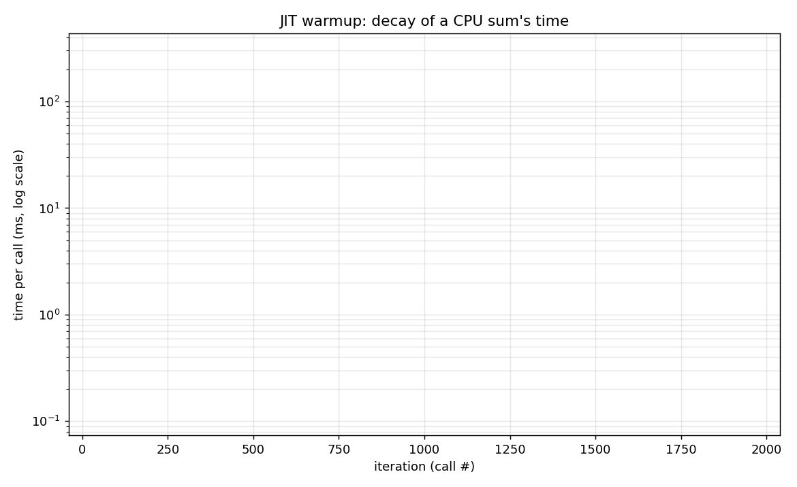
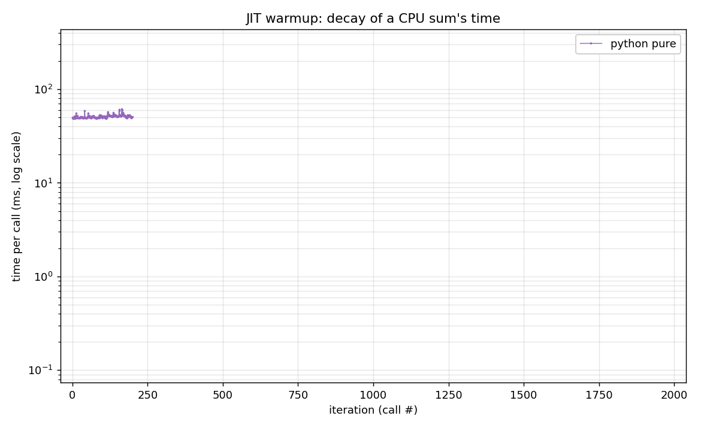
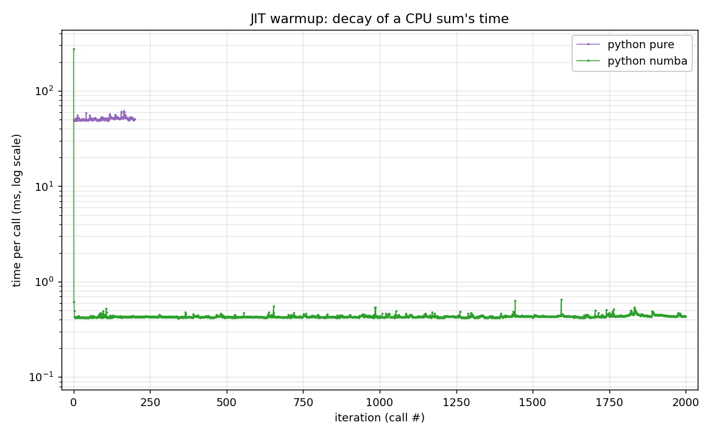
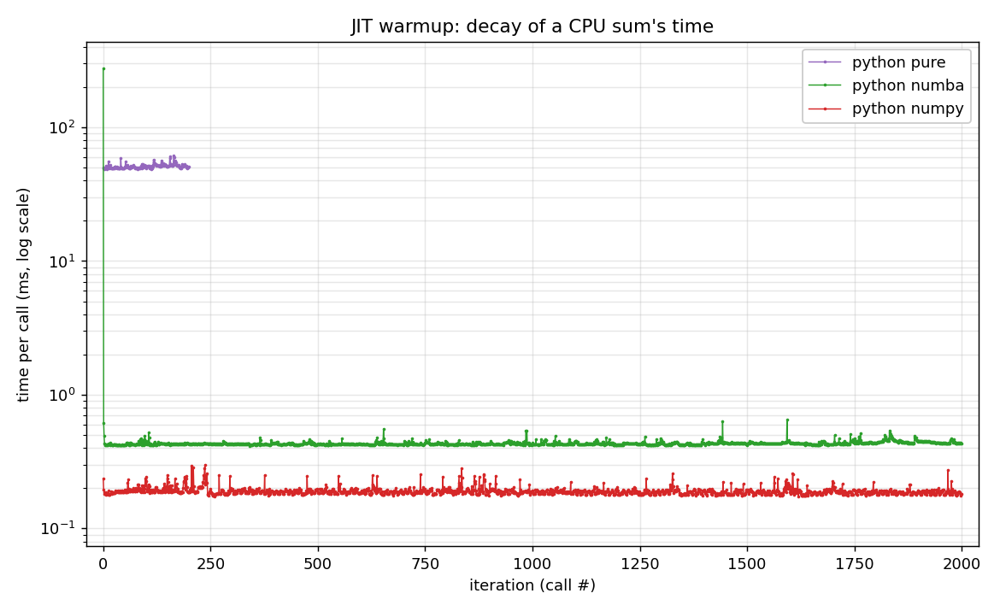
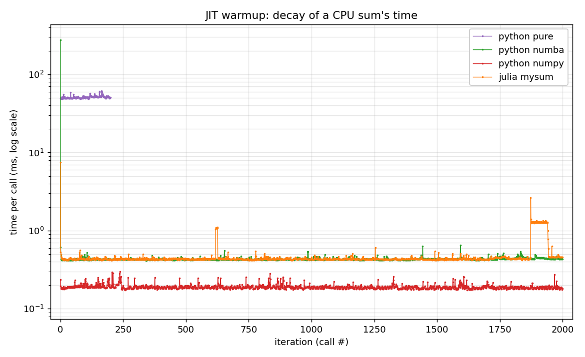
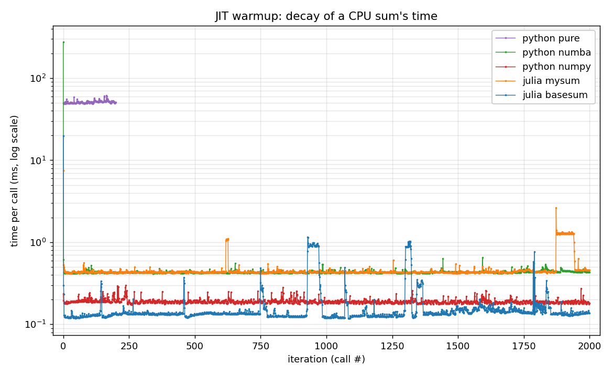

## Goals

:::{.nonincremental}
- From source code to the processor
- **Type specialization** (Julia ≈ C)
- **Measuring** performance properly
:::

. . .

> ▶ Script: [1_compilation_and_types.jl](../scripts/1_compilation_and_types.jl) · Notebook: [Interpreted vs compiled](../pluto/1_compilation_and_types.jl) · 🐍 Python: [1_compilation_and_types_python.ipynb](../python/1_compilation_and_types_python.ipynb)

. . .

> ⬅ **Previous:** [0 — Julia for Python users](0_julia_basics.qmd)  ·  **Next:** [2 — Multiple dispatch vs OOP](2_dispatch_vs_oop.qmd) ➡

# The JIT warmup {style="text-align: center;"}

## A tale of two ships {.smaller}

. . .

::: {.r-stack}
{width="82%"}

{.fragment width="82%"}
:::

## The loop we will study

. . .

```julia
function mysum(x)
    s = zero(eltype(x))     # 0.0 here
    for i in eachindex(x)
        s += x[i]
    end
    return s
end
```

- Pure Python, 10⁷ floats: **~0.5 s**
- Julia: a few **ms**
- [Same loop, same machine. Why the gap?]{style="background-color: yellow;"}

## The experiment

- Sum 10⁶ floats, **2000 calls**, time **each call**
- 5 variants: pure Python, `numba @njit`, `numpy`, Julia `mysum`, Julia `sum`

. . .

> What happens **on the very first call**?

## Warmup: the curves appear

. . .

::: {.r-stack}
{width="82%"}

{.fragment width="82%"}

{.fragment width="82%"}

{.fragment width="82%"}

{.fragment width="82%"}

{.fragment width="82%"}
:::

## Reading the curves

. . .

| variant | 1st-call spike | plateau |
|---|---|---|
| pure Python | **0** | ~50 ms |
| numba `@njit` | **~270 ms** | ~0.4 ms |
| numpy | ≈ 0 | ~0.2 ms |
| Julia `mysum` | ~7 ms | ~0.4 ms |
| Julia `sum` | ~20 ms | ~0.1 ms |

. . .

> **Spike then fast** (numba, Julia) · **no spike** (Python slow, numpy fast). Why?

## Three ways to run code

- **Interpreted** (CPython): re-examined at run time → instant start, **slow**
- **AOT** (C, `numpy`): compiled before → fast, **no warmup**
- **JIT** (Julia, numba): compiled **on 1st call** → fast *after*

. . .

> The spike **is** the JIT compiling. Paid once.

::: {.notes}
Interpreted: each operation is re-examined at run time (bytecode visible with `dis` in the Python notebook).
AOT = ahead-of-time, JIT = just-in-time. The JIT cost is amortized over later calls.

Don't say "Python can't specialize by type" — false since 3.11 (PEP 659): the adaptive
interpreter rewrites a hot `s += x` into `BINARY_OP_ADD_FLOAT`. The point is that it
specializes ONE bytecode and KEEPS the guard, inside the interpreter, on boxed objects.
Julia specializes the whole function and deletes the guard. That's why the 100× survives.
:::

## numpy: fast, but only inside

. . .

`numpy.sum`: **the loop is compiled C**.

- Python `for` over a numpy array: slow again
- Python: **vectorize** — push loops into numpy
- Julia: [your own loop is compiled too]{style="background-color: yellow;"}

::: {.notes}
A Python `for` loop over a numpy array is slow because each element crosses back into the interpreter.
In Julia there is no such boundary.
:::

# Measuring properly {style="text-align: center;"}

## Pitfall 1: timing the compiler

. . .

```julia
g(x) = sum(abs2, x)
@time g(v)   # compile + compute
@time g(v)   # compute only
```

. . .

> Discard the 1st call; measure the **steady state**.

. . .

> ▶ Script: cell "0. Getting started", then "2. Measuring properly — compare the two timings"

::: {.notes}
The very first line of a session is slow for the same reason: everything it touches
(here `@btime` and BenchmarkTools) gets compiled.
:::

## Pitfall 2: measuring only once

. . .

```julia
using BenchmarkTools
@btime     mysum($v)   # minimum
@benchmark mysum($v)   # distribution
```

- Many runs, warmup **dropped**
- `$v` **plugs the value in**: time `mysum`, not the global lookup (why: with dispatch)
- [Always `$` before globals in `@btime`]{style="background-color: yellow;"}

::: {.notes}
`@btime` / `@benchmark` run the call many times and drop the warmup for you.
Without `$`, we would also time the lookup of the untyped global variable `v`.
Why an untyped global is slow: with dispatch, when the compiler cannot know the type.
:::

. . .

> ▶ Script: cell "Read the distribution: why is the minimum the number to quote?"

# Type specialization {style="text-align: center;"}

## One `x + y`, several machine codes

. . .

No single "`x + y`" instruction: it depends on the **types**.

. . .

| `x`, `y` | machine code for `x + y` |
|---|---|
| `Int, Int` | `add` (integer) |
| `Float64, Float64` | `vaddsd` (float) |
| `Float64, Int` | `vcvtsi2sd` + `vaddsd` (convert + add) |

. . .

> **Julia**: 1st call compiles a version **for the concrete types**, then reuses it.
> No type checks left → **≈ C**.

::: {.notes}
Each entry in the table is one (or two) processor instructions.
Picking the version from the types of ALL arguments is multiple dispatch — next module.
:::

## Watching the compiler

. . .

```julia
f(x) = 2x + 1

@code_lowered f(3.0)   # desugared
@code_typed   f(3.0)   # types inferred
@code_native  f(3.0)   # assembly
```

. . .

> Try `f(3.0)` **and** `f(3)`. What changes?

. . .

> ▶ Script: cells "3. Type specialization — step 1" to "Step 3, with an Int"

## Same `f`, two compilations {.smaller}

. . .

:::: {.columns}
::: {.column width="48%"}
`f(3.0)` — `Float64`

```
mul_float(2.0, x)
add_float(%1, 1.0)
```

```asm
vaddsd  xmm0, xmm0, xmm0
vaddsd  xmm0, xmm0, [1.0]
```
:::
::: {.column width="48%"}
`f(3)` — `Int`

```
mul_int(2, x)
add_int(%1, 1)
```

```asm
lea     rax, [2*rdi + 1]
```
:::
::::

- One line, **two native functions**
- No type check: types **known at compile time**
- Not known? **Type instability**, with dispatch

# Bonus (optional): why `sum` beats `mysum` {style="text-align: center;"}

## The gap to explain

. . .

10⁵ floats (fits in cache):

. . .

| | time / call |
|---|---|
| `mysum` | **44 µs** |
| Base `sum` | **7.5 µs** |

. . .

> **~6× apart**. `@code_native` tells why.

. . .

> ▶ Script: cells "4. Bonus (optional)" to "The kernel `sum` calls"

## `mysum`: what to look for

. . .

```asm
vaddsd  xmm0, xmm0, [rcx + 8*rdx]
vaddsd  xmm0, xmm0, [rcx + 8*rdx + 8]
...
```

- `vaddsd` = **S**calar **D**ouble → [1 float / instruction]{style="background-color: yellow;"}
- Always `xmm0` → **one accumulator**: each `+` waits for the previous

## `sum`: what to look for

. . .

`@code_native sum(vc)` is mostly a `call`; the work is in `Base.mapreduce_impl`:

. . .

```asm
vaddpd  ymm0, ymm0, [r8 + 8*r9 - 96]
vaddpd  ymm1, ymm1, [r8 + 8*r9 - 64]
vaddpd  ymm2, ymm2, [r8 + 8*r9 - 32]
vaddpd  ymm3, ymm3, [r8 + 8*r9]
```

- `vaddpd` = **P**acked **D**ouble → [4 floats / instruction (SIMD)]{style="background-color: yellow;"}
- **4 accumulators** `ymm0…ymm3` → 4 independent chains

## Why not our loop?

. . .

**Bet first:** why can't the compiler do this for *our* loop?

## What we saw: the order of the additions

. . .

::: {.callout-warning}
Float `+` is **not associative**: `(a+b)+c ≠ a+(b+c)`.
The compiler **must** keep our order → scalar.
:::

. . .

`sum` allows reordering → vectorized.

## `@simd`: permission to reorder {.smaller}

. . .

```julia
function mysum_simd(x)
    s = zero(eltype(x))
    @inbounds @simd for i in eachindex(x)   # ← @simd
        s += x[i]
    end
    return s
end
```

`@inbounds`: no bounds checks · `@simd`: may reorder `+`

. . .

| variant | time / call |
|---|---|
| `mysum` (scalar) | **44 µs** |
| `mysum_simd` (`vaddpd`) | **~4 µs** |
| Base `sum` | 7.5 µs |

. . .

> Not magic: **the algorithm** (reordering → SIMD), not the language.

# Monte-Carlo π {style="text-align: center;"}

## Estimating π

. . .

```julia
estimate_pi(n) = 4 * count_in_disk(n) / n
```

1. Time and allocations of `estimate_pi(10_000_000)`?
2. Type-stable? `@code_warntype` = `@code_typed`, uncertain types in color
3. How does the error shrink with `n`? Why ideal for parallelism?

::: {.notes}
Same count as in the Julia-basics module; here we measure it and check its types.
Q2: red `Any` = bad (none here); yellow `Union{Nothing, Tuple…}` = the `for` iterator, harmless.
The red `Any` and its cost are shown with dispatch (global vs argument).
:::

. . .

> ▶ Script: cells "5. Monte-Carlo π" to "Q3"

## Going further

:::{.nonincremental}
- ▶ [Script](../scripts/1_compilation_and_types.jl) · [Notebook](../pluto/1_compilation_and_types.jl) · 🐍 [Python notebook](../python/1_compilation_and_types_python.ipynb)
- ✏️ Activity: [Julia](../activities/release/1_warmup_julia_todo.jl) · 🐍 [Python (Colab)](https://colab.research.google.com/github/epilliat/epilliat.github.io/blob/master/docs/teaching/parallel_computing/activities/release/1_warmup_python_todo.ipynb)
- 🔬 JIT warmup: [`warmup_jit/`](../experiences/warmup_jit/)
- 🔬 asm, `@simd`: [`sum_vs_size/reflection.jl`](../experiences/sum_vs_size/reflection.jl)
:::

. . .

> 🎯 Concrete types → specialized code (≈ C) · `@btime f($x)`

. . .

> ⬅ **Previous:** [0 — Julia for Python users](0_julia_basics.qmd)  ·  **Next:** [2 — Multiple dispatch vs OOP](2_dispatch_vs_oop.qmd) ➡
