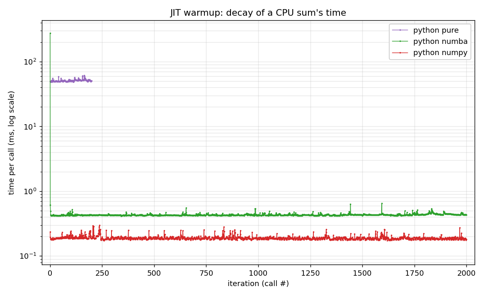
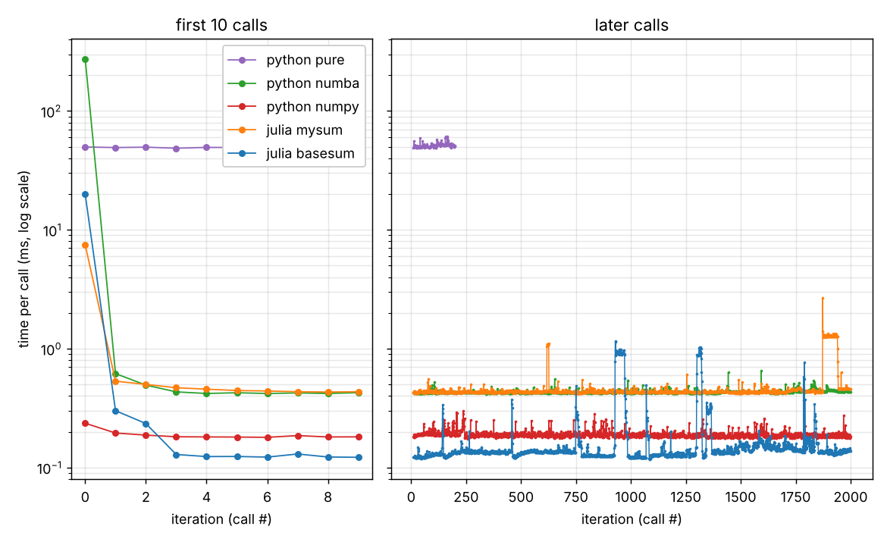

## Today's path {#path}

:::{.nonincremental}
1. **The JIT warmup**: why the first call is slow. ✏️ [what does a loop cost?](#a1)
2. **Measuring properly**: the measurement card.
3. **π, measured**: what "correct" means when the result is random.
4. **Which block is worth it?** ✏️ [diagnose before optimizing](#a2)
:::

. . .

> Only if time: [the compiler](#appendix-compiler) · [why `sum` beats our loop](#appendix-simd)

::: {.notes}
Session 1, minutes 25–140. The two appendices sit after the wrap-up slide: skip them unless a
group asks. The assembly is never needed for the activities or the project.
:::

## By the end, you can

:::{.nonincremental}
- separate **compile time** from **run time**;
- write down a **valid measurement**;
- say which block **deserves the effort**.
:::

. . .

> ▶ [Script](../scripts/1_compilation_and_types.jl) · [Notebook](../pluto/1_compilation_and_types.jl) · 🐍 [Python](../python/1_compilation_and_types_python.ipynb)

. . .

> ⬅ [0 — Julia for Python users](0_julia_basics.qmd)  ·  **Next:** [2 — Multiple dispatch vs OOP](2_dispatch_vs_oop.qmd) ➡

# The JIT warmup {style="text-align: center;"}

## Speed bolted on, or built in? {.smaller}

. . .

::: {.r-stack}
{width="82%"}

{.fragment width="82%"}
:::

## The loop we will study

. . .

```julia
function mysum(x)
    s = zero(eltype(x))     # 0.0 here
    for i in eachindex(x)
        s += x[i]
    end
    return s
end
```

- Pure Python, 10⁷ floats: **~0.5 s**
- Julia: a few **ms**
- [Same loop, same machine. Why the gap?]{style="background-color: yellow;"}

## The experiment

- Sum 10⁶ floats, **2000 calls**, time **each call**
- 5 variants: pure Python, `numba @njit`, `numpy`, Julia `mysum`, Julia `sum`

. . .

> Rank the five. What happens **on the very first call**?

## Warmup: the curves appear

. . .

::: {.r-stack}
{width="82%"}

{.fragment width="82%"}

{.fragment width="82%"}

{.fragment width="82%"}

{.fragment width="82%"}

{.fragment width="82%"}

{.fragment width="82%"}
:::

## Reading the curves

. . .

| variant | **1st call** | **later calls** |
|---|---|---|
| pure Python | no spike | ~50 ms |
| numba `@njit` | **~270 ms** | ~0.4 ms |
| numpy | no spike | ~0.2 ms |
| Julia `mysum` | ~7 ms | ~0.4 ms |
| Julia `sum` | ~20 ms | ~0.1 ms |

. . .

> Two numbers per variant: **first call**, **steady state**.

::: {.notes}
Last frame of the plot: the first calls on their own panel. Spike then fast (numba, Julia); no spike (Python slow, numpy fast). Why? Next slide.
:::

## Three ways to run code

- **Interpreted** (CPython): each operation decoded again, every time → instant start, **slow**
- **AOT** (C, `numpy` internals): compiled before you run → fast, **no warmup**
- **JIT** (Julia, numba): compiled **on 1st call** → fast *after*

. . .

> The spike **is** the JIT compiling. Paid once.

::: {.notes}
Interpreted: each operation is re-examined at run time (bytecode visible with `dis` in the Python notebook).
AOT = ahead-of-time, JIT = just-in-time. The JIT cost is amortized over later calls.

Don't say "Python can't specialize by type" — false since 3.11 (PEP 659): the adaptive
interpreter rewrites a hot `s += x` into `BINARY_OP_ADD_FLOAT`. The point is that it
specializes ONE bytecode and KEEPS the guard, inside the interpreter, on boxed objects.
Julia specializes the whole function and deletes the guard. That's why the 100× survives.
:::

## What gets compiled: one version per type

. . .

No single "`x + y`" instruction: it depends on the **types**.

. . .

| `x`, `y` | machine code for `x + y` |
|---|---|
| `Int, Int` | integer add |
| `Float64, Float64` | float add |
| `Float64, Int` | convert, then float add |

. . .

> **JIT**: the 1st call compiles a version **for these types**, then reuses it.

::: {.notes}
The interpreter asks "which + ?" at every iteration; the compiled version asked once.
Instruction names (`add`, `vaddsd`, `vcvtsi2sd`) and `@code_native`: appendix, only if asked.
Picking the version from the types of ALL arguments is multiple dispatch — next module.
:::

## numpy: fast, but only inside

. . .

`numpy.sum`: **the loop is compiled C**.

- Python `for` over a numpy array: slow again
- Python: **vectorize** — push loops into numpy
- Julia, numba: [your own loop is compiled too]{style="background-color: yellow;"}

::: {.notes}
A Python `for` loop over a numpy array is slow because each element crosses back into the interpreter.
In Julia there is no such boundary.
:::

## ✏️ What does a loop cost? {#a1}

:::{.nonincremental}
- **Question:** same sum: Python loop, `numpy`, `numba`. How far apart? What does the 1st call cost?
- **Alone:** write your ranking and one ratio, **before** running (2 min).
- **In pairs:** fill the two functions, check the assertion.
- **Write down:** first call · steady times · ratios · one sentence explaining the gap.
:::

. . .

> 🐍 [Python (Colab)](https://colab.research.google.com/github/epilliat/epilliat.github.io/blob/master/docs/teaching/parallel_computing/activities/release/1_warmup_python_todo.ipynb) · [local .py](../activities/release/1_warmup_python_todo.py) · [Julia](../activities/release/1_warmup_julia_todo.jl) · **20 min**

::: {.notes}
Python is the common track; the Julia file is the same task for volunteers.
Walk around: the usual blocker is `range(x.shape[0])` inside numba, not the idea.
:::

## Debrief: what does a loop cost? {#a1-debrief}

:::{.nonincremental}
- **Compare:** same ratios as your neighbors? If not: N, type, machine?
- **Explain:** where did the interpreter cost go, in `numpy`? in `numba`?
- **Test:** which measurement separates *compiling* from *running*?
:::

. . .

> A ratio across **two machines** says nothing about a language.

::: {.notes}
Expected: the hand loop pays the interpreter at every iteration; numpy sidesteps it (compiled C),
numba removes it (compiles your loop). The first numba call includes compilation.
Typical orders of magnitude: loop/numpy ~70–100×.
:::

# Measuring properly {style="text-align: center;"}

## Pitfall 1: timing the compiler

. . .

```julia
g(x) = sum(abs2, x)
@time g(v)   # compile + compute
@time g(v)   # compute only
```

. . .

> Report the 1st call **separately**; compare **steady states**.

. . .

> ▶ Script: cell "0. Getting started", then "2. Measuring properly — compare the two timings"

::: {.notes}
The very first line of a session is slow for the same reason: everything it touches
(here `@btime` and BenchmarkTools) gets compiled.
The first call is not noise to hide: for a script run once, it is part of the cost.
:::

## Pitfall 2: measuring only once

. . .

```julia
using BenchmarkTools
@btime     mysum($v)   # minimum
@benchmark mysum($v)   # distribution
```

- Many runs, warmup **dropped**
- `$v` **plugs the value in**: time `mysum`, not the global lookup (explained in the dispatch module)
- Python: `timeit`, or `perf_counter` around repeated calls

. . .

> ▶ Script: cell "Read the distribution: why is the minimum the number to quote?"

::: {.notes}
`@btime` / `@benchmark` run the call many times and drop the warmup for you.
Without `$`, we would also time the lookup of the untyped global variable `v`.
Why an untyped global is slow: with dispatch, when the compiler cannot know the type.
:::

## The measurement card {#card}

. . .

Every timing, here and in your project, comes with five lines:

. . .

| | |
|---|---|
| **Result** | what was checked, and how |
| **Input** | size and type |
| **Machine** | hardware, workers, BLAS threads |
| **Repetition** | warmup, number of runs, statistic |
| **Scope** | which costs are inside the timer |

. . .

> No card, no number. Compare [**ratios on one machine**]{style="background-color: yellow;"}.

::: {.notes}
Reused as is in every activity (the 📋 on the launch slides) and required in the project report.
"Scope" is the line students forget: data generation, compilation, pool startup, transfers.
:::

# Monte-Carlo π, measured {style="text-align: center;"}

## Estimating π

. . .

```julia
estimate_pi(n) = 4 * count_in_disk(n) / n
```

1. Time and allocations of `estimate_pi(10_000_000)`?
2. Type-stable? `@code_warntype` shows inferred types, uncertain ones in color
3. How does the error shrink with `n`? Why ideal for parallelism?

. . .

> ▶ Script: cells "3. Monte-Carlo π" to "Q3"

::: {.notes}
Same count as in the Julia-basics module; here we measure it and check its types.
Q2: red `Any` = bad (none here); yellow `Union{Nothing, Tuple…}` = the `for` iterator, harmless.
The red `Any` and its cost are shown with dispatch (global vs argument).
Q3: every draw is independent of the others: nothing to share between workers.
:::

## A random result: what does "correct" mean?

- Two runs give **two different** estimates. Neither equals π.
- Standard error ≈ $1.64/\sqrt{n}$: about **0.0016** at `n = 10⁶`.

. . .

> Check with a **tolerance** of a few standard errors, never with `==`.

. . .

> To check the code itself: an input whose count you know exactly.

::: {.notes}
Standard error = 4·sqrt(p(1−p)/n) with p = π/4; 100× more draws for one more digit.
A known count: fixed points or a fixed seed.
This is the "Result" line of the card for the whole running example. It comes back with
threads (a wrong parallel π is 10× off, far outside any tolerance) and on the GPU (four fixed
points with a known count of 3).
:::

# Which block is worth it? {style="text-align: center;"}

## Local gain ≠ whole-program gain {#amdahl}

. . .

A block takes a fraction $f$ of the time and becomes $s$× faster:

. . .

$$\text{whole-program speedup} = \frac{1}{(1-f) + f/s}$$

. . .

Which one helps more?

- **A**: 10 % of the time, **10×** faster.
- **B**: 80 % of the time, **2×** faster.

::: {.notes}
A: 1/(0.9 + 0.01) = 1.10×. B: 1/(0.2 + 0.4) = 1.67×. Even an infinitely fast A caps at 1.11×.
Give the numbers only in the diagnosis debrief. Same formula as Amdahl's law in the threads module:
there, s is the number of cores.
:::

## ✏️ Diagnose before optimizing {#a2}

:::{.nonincremental}
- **Question:** three timed stages. Which one to change? What does the **whole** job gain?
- **Alone:** predict the overall gain (3 min).
- **In pairs:** time the stages, replace one, check the output is unchanged.
- **Write down:** stage table · local gain · predicted vs observed gain. 📋 [card](#card)
:::

. . .

> 🐍 [Python (Colab)](https://colab.research.google.com/github/epilliat/epilliat.github.io/blob/master/docs/teaching/parallel_computing/activities/release/1_diagnostic_python_todo.ipynb) · [local .py](../activities/release/1_diagnostic_python_todo.py) · **20 min**

::: {.notes}
Coarse timers around big functions are enough: this is not a profiling lesson.
:::

## Debrief: diagnose before optimizing {#a2-debrief}

:::{.nonincremental}
- **Compare:** predicted vs observed overall gain.
- **Explain:** A gives **1.10×**, B gives **1.67×**; even an instantaneous A gives at most 1.11×.
- **Test:** which stage would you time next?
:::

. . .

> Your project reports both: [**gain on the block, gain on the whole program**]{style="background-color: yellow;"}.

::: {.notes}
After the change the dominant stage is usually a different one: the diagnosis has to be redone.
Differences between model and measurement: noise, allocations, costs that moved.
:::

## What we keep

:::{.nonincremental}
- First call ≠ steady state: report both.
- A number comes with its **card**.
- A random result is checked with a **tolerance**.
- Optimize what **dominates**; verify on the **whole** program.
:::

. . .

> **Next:** [2 — Multiple dispatch vs OOP](2_dispatch_vs_oop.qmd) ➡ · 🔬 [`warmup_jit/`](https://github.com/epilliat/epilliat.github.io/tree/master/teaching/parallel_computing/experiences/warmup_jit)

# Only if time — watching the compiler {#appendix-compiler style="text-align: center;"}

## Watching the compiler

. . .

```julia
f(x) = 2x + 1

@code_lowered f(3.0)   # desugared
@code_typed   f(3.0)   # types inferred
@code_native  f(3.0)   # assembly
```

. . .

> Try `f(3.0)` **and** `f(3)`. What changes?

. . .

> ▶ Script: cells "4. Optional — type specialization" to "Step 3, with an Int"

## Same `f`, two compilations {.smaller}

. . .

:::: {.columns}
::: {.column width="48%"}
`f(3.0)` — `Float64`

```
mul_float(2.0, x)
add_float(%1, 1.0)
```

```asm
vaddsd  xmm0, xmm0, xmm0
vaddsd  xmm0, xmm0, [1.0]
```
:::
::: {.column width="48%"}
`f(3)` — `Int`

```
mul_int(2, x)
add_int(%1, 1)
```

```asm
lea     rax, [2*rdi + 1]
```
:::
::::

- One line, **two native functions**
- No type check: types **known at compile time**
- Not known? **Type instability**, with dispatch

# Only if time — why `sum` beats `mysum` {#appendix-simd style="text-align: center;"}

## The gap to explain

. . .

10⁵ floats (fits in cache):

. . .

| | time / call |
|---|---|
| `mysum` | **44 µs** |
| Base `sum` | **7.5 µs** |

. . .

> **~6× apart**. `@code_native` tells why.

. . .

> ▶ Script: cells "5. Optional — Base `sum` vs our loop" to "The kernel `sum` calls"

## `mysum`: what to look for

. . .

```asm
vaddsd  xmm0, xmm0, [rcx + 8*rdx]
vaddsd  xmm0, xmm0, [rcx + 8*rdx + 8]
...
```

- `vaddsd` = **S**calar **D**ouble → [1 float / instruction]{style="background-color: yellow;"}
- Always `xmm0` → **one accumulator**: each `+` waits for the previous

## `sum`: what to look for

. . .

`@code_native sum(vc)` is mostly a `call`; the work is in `Base.mapreduce_impl`:

. . .

```asm
vaddpd  ymm0, ymm0, [r8 + 8*r9 - 96]
vaddpd  ymm1, ymm1, [r8 + 8*r9 - 64]
vaddpd  ymm2, ymm2, [r8 + 8*r9 - 32]
vaddpd  ymm3, ymm3, [r8 + 8*r9]
```

- `vaddpd` = **P**acked **D**ouble → [4 floats / instruction (SIMD)]{style="background-color: yellow;"}
- **4 accumulators** `ymm0…ymm3` → 4 independent chains

## Why not our loop?

. . .

Why can't the compiler do this for *our* loop?

## What we saw: the order of the additions

. . .

::: {.callout-warning}
Float `+` is **not associative**: `(a+b)+c ≠ a+(b+c)`.
The compiler **must** keep our order → scalar.
:::

. . .

`sum` allows reordering → vectorized.

## `@simd`: permission to reorder {.smaller}

. . .

```julia
function mysum_simd(x)
    s = zero(eltype(x))
    @inbounds @simd for i in eachindex(x)   # ← @simd
        s += x[i]
    end
    return s
end
```

`@inbounds`: no bounds checks · `@simd`: may reorder `+`

. . .

| variant | time / call |
|---|---|
| `mysum` (scalar) | **44 µs** |
| `mysum_simd` (`vaddpd`) | **~4 µs** |
| Base `sum` | 7.5 µs |

. . .

> The gain comes from **the algorithm** (reordering → SIMD), not from the language.

. . .

> 🔬 asm, `@simd`: [`sum_vs_size/reflection.jl`](../experiences/sum_vs_size/reflection.jl) · ⬅ [Back to the path](#path)
