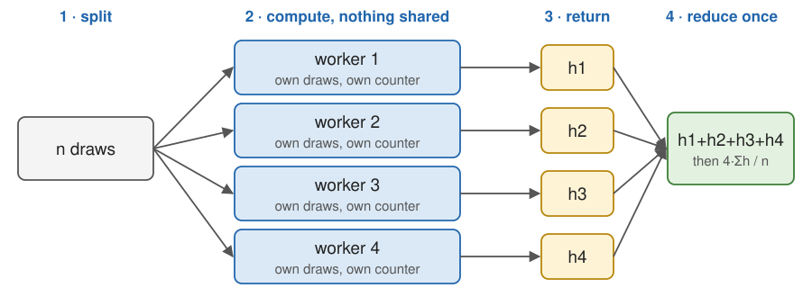

## Today's path {#path}

:::{.nonincremental}
1. **Waiting**: overlap the waits. ✏️ [A3a](#a3a)
2. **Computing**: the GIL, then a real split over cores.
3. **The parallel sum that lies**: a race, step by step. ✏️ [A3b](#a3b)
4. **Return and reduce**: π in lots. ✏️ [A3c](#a3c)
5. **Why not N× on N cores?**
:::

. . .

> Only if time: [Markov chains, lazy coroutines](#appendix) · ✏️ [A3d, your own slow server](#a3d)

::: {.notes}
Session 2, the whole three hours. Start with a 10-minute recall, no slide: what result must be
preserved, what is inside the timer, what the first call costs.
Parallelism starts here: compilation and dispatch made one core fast; now we use many.
:::

## By the end, you can

:::{.nonincremental}
- tell **waiting** from **computing**;
- spot a **shared update**;
- **split and reduce** a computation;
- explain a speedup **below** the worker count.
:::

. . .

> ▶ [Script](../scripts/3_threads_and_concurrency.jl) · [Notebook](../pluto/3_threads_and_concurrency.jl) · 🐍 [Python](../python/3_threads_and_concurrency_python.ipynb)

. . .

> ⬅ [2 — Dispatch](2_dispatch_vs_oop.qmd)  ·  **Next:** [4 — Memory & batching](4_memory_and_batching.qmd) ➡

# Two problems, two tools {style="text-align: center;"}

## Concurrency ≠ parallelism

. . .

| | the time goes into… | fix | cores needed |
|---|---|---|---|
| **Concurrency** | **waiting** (network, disk) | **overlap** the waits | one is enough |
| **Parallelism** | **computing** | **split** the work | several |

. . .

> **Waiting is overlapped; computing must be split.**

::: {.notes}
"One core" describes our demos, not a definition: concurrent tasks may also run on several
cores. The idea to keep is overlapping waits versus executing computations at the same time.
Pick the wrong one: all the complexity, none of the speed. We will measure it.
:::

# Part A — overlap the waiting {style="text-align: center;"}

## Fetching 15 prices

- 15 HTTP requests to Binance, **~0.25 s** wait each.
- One by one = **15 waits in a row**, CPU idle.

. . .

```julia
@async expr     # start a task, return at once
@sync begin     # wait for every @async inside
    ...
end
```

. . .

> One core is enough: only **waiting** to overlap.

## Three ways to fetch

. . .

```julia
for i in 1:n                         # 1) sequential
    seq[i] = fetch_price(SYMBOLS[i])
end
for i in 1:n                         # 2) @async, no @sync
    @async bad[i] = fetch_price(SYMBOLS[i])
end
@sync for i in 1:n                   # 3) @sync + @async
    @async good[i] = fetch_price(SYMBOLS[i])
end
```

. . .

> **Bet first:** how long does each one take?

. . .

> ▶ Script: cell "Three ways to fetch"

## Three ways to fetch: the timings

. . .

| | time | what happened |
|---|---|---|
| 1) sequential | **~4 s** | sum of 15 waits |
| 2) `@async` **without** `@sync` | **~10 µs** | ⚠️ timed **task creation** only |
| 3) `@sync` + `@async` | **~0.3 s** | ≈ one round-trip |

- Row 2: "400 000× faster" — **wrong**, data not there yet.
- `@sync`: honest timing **and** correct result.

. . .

> Stop the timer when the **results are there**.

::: {.notes}
Network-dependent: your latency will differ. The shape (sum of latencies → one
round-trip) is the lesson, not the exact seconds. Run it live if the wifi allows.
The script prints "x/15 ready" for row 2, then again 2 s later: 15/15.
Async overlaps waiting, not computing. Row 2 is the "Scope" line of the measurement card.
:::

## The same pattern in Python

. . .

```python
from concurrent.futures import ThreadPoolExecutor

def download_all(days):
    with ThreadPoolExecutor(max_workers=len(days)) as pool:
        return list(pool.map(close_of, days))   # results, in input order
```

- `pool.map` **submits** every call; leaving `with` **waits** for all.

. . .

> `with` + `map` = `@sync` + `@async`: **submit all, wait for all**.

::: {.notes}
This is the structure the activity asks for. `asyncio.gather` is the coroutine version of the
same idea (appendix slide "Julia didn't wait; Python didn't start").
:::

## ✏️ A3a — overlap the waits {#a3a}

:::{.nonincremental}
- **Question:** 20 downloads, one by one or all at once. How long each?
- **Alone:** predict both times (3 min).
- **In pairs:** write the concurrent submission; check you get the **same 20 values**.
- **Write down:** two times, measured until the results are there · ratio · real or simulated. 📋 [card](1_compilation_and_types.qmd#/card)
:::

. . .

> 🐍 [Python (Colab)](https://colab.research.google.com/github/epilliat/epilliat.github.io/blob/master/docs/teaching/parallel_computing/activities/release/3_concurrency_python_todo.ipynb) · [local .py](../activities/release/3_concurrency_python_todo.py) · [Julia, Part A](../activities/release/3_concurrency_julia_todo.jl) · **20 min**

::: {.notes}
If the network is down the notebook switches to labelled simulated waits: same lesson, not an
Internet benchmark. Python and Julia use different endpoints: no cross-language timing.
:::

## A3a — debrief {#a3a-debrief}

:::{.nonincremental}
- **Compare:** is the ratio close to 20? What limits it?
- **Explain:** why do threads help here, on one core?
- **Test:** would this speed up a pure-Python arithmetic loop?
:::

. . .

> Classify first: is the time spent *waiting* or *computing*?

::: {.notes}
Limits: server, bandwidth, connection setup, the slowest request. The last question is the
bridge to Part B: let them commit to an answer before the next slide.
:::

# Part B — split the computing {style="text-align: center;"}

## Python threads on CPU work: the GIL {#gil}

- GIL: one thread runs **Python bytecode** at a time.
- **Released** while waiting, and inside many **native** routines (NumPy, BLAS).

. . .

| `ThreadPoolExecutor` on… | speedup |
|---|---|
| **I/O** (15 URLs) | **~10×** |
| **CPU**, pure-Python loop | **~1×** |

. . .

> *"Threads are pointless in Python"*: [**false**]{style="background-color: yellow;"}. It depends on **where the time goes**.

::: {.notes}
Same threads, same GIL; what changed is waiting vs computing.
Pure-Python CPU loops need processes. Native NumPy work is another case: it may release the
GIL and is often already multithreaded by BLAS — essential for a real NumPy project.
Ageing caveat: true for default CPython. Free-threaded builds (PEP 703) are
officially supported since 3.13/3.14 and remove the GIL — say "default CPython".
:::

## Splitting the computing in Julia

. . .

```julia
t = Threads.@spawn f()   # may run on another core
fetch(t)                 # wait, get the result
```

- Needs `julia --threads=auto` (else `nthreads() = 1`).
- Our machine: `Threads.nthreads() = 22`. Julia has no GIL.

. . .

> `@async` and `@spawn` look alike. Only one uses more cores.

## Same CPU work, with `@async`

. . .

> **Bet first:** π (`n = 10⁸`), `@async` × 22: speedup? ▶ Script: cell "Same CPU work with @async"

. . .

| | time | speedup |
|---|---|---|
| `pi_seq` (one core) | 0.357 s | — |
| `@async` × 22 | 0.332 s | [**1.1×**]{style="background-color: yellow;"} |
| `@spawn` × 22 | 0.057 s | **6.3×** |


::: {.notes}
count_in_disk is the same count as in the compilation module; only the macro changes (who runs it).
@async: one core, nothing to overlap. @spawn: the tasks land on different cores.
Script cells "Same CPU work with @async" (seq, @async) and "Speedup vs nthreads" (@spawn).
@async never passed ~1.3x at any task count tried (1 -> 22).
No speedup-vs-ntasks curve here: in one session the OS may place few tasks on
5 GHz P-cores or 2.5 GHz LP-E cores (measured 1.3x at 4 tasks but 4.7x at 6).
The honest curve needs one process per point: experiences/threads_scaling/.
:::

# The parallel sum that lies {style="text-align: center;"}

## Bet before you look 🎲 {style="text-align: center;"}

. . .

π on all 22 threads, 20 million points, one task per thread.

. . .

```julia
hits = 0
@sync for _ in 1:ntasks
    Threads.@spawn for _ in 1:per
        x = rand(); y = rand()
        hits += (x * x + y * y <= 1.0)
    end
end
```

. . .

> **What does it print?** ▶ Script: cell "π on all threads, one task per thread: what does it print?"

## The parallel sum that lies

. . .

| | run 1 | run 2 | run 3 | run 4 |
|---|---|---|---|---|
| `pi_race` | **0.219** | **0.361** | **0.354** | **0.393** |
| `pi_spawn` | 3.14126 | 3.14174 | 3.14172 | 3.14146 |

- **10× too small**, different every run.

. . .

::: {.callout-warning}
**No error. No warning. Just a wrong number.**
:::

::: {.notes}
Your values WILL differ — that is the point (non-determinism). Never quote a fixed
number here; run it live and let the class watch it change.
A demo machine may not show a spectacular error: the interleaving on the next slide is the
expected result, not the size of the error.
:::

## ✏️ A3b — on the board: who wrote last? {#a3b .smaller}

. . .

`hits` is 7. Two tasks each run `hits += 1`. Write the six steps in **one** possible order.

. . .

| step | task A | task B | `hits` in memory |
|---|---|---|---|
| 1 | **read** 7 | | 7 |
| 2 | | **read** 7 | 7 |
| 3 | **add** → 8 | | 7 |
| 4 | | **add** → 8 | 7 |
| 5 | **write** 8 | | 8 |
| 6 | | **write** 8 | [**8**, not 9]{style="background-color: yellow;"} |

. . .

> `hits += 1` is **three** operations: an increment is **lost**.

::: {.notes}
5 minutes in pairs before revealing the table. Ask for a second order that gives 9 (A finishes
before B reads): the bug is intermittent, which is why it survives testing.
Then: where would you put the addition so that nothing is shared? → next slide.
:::

## The cure: return and reduce

. . .

```julia
function pi_spawn(n; ntasks=Threads.nthreads())
    per = n ÷ ntasks
    tasks = [Threads.@spawn count_in_disk(per) for _ in 1:ntasks]
    return 4 * sum(fetch, tasks) / (per * ntasks)
end
```

. . .

> No shared counter in the hot loop: **correct and fast**.

. . .

> ▶ Script: cell "The cure"

::: {.notes}
Each task returns its own count; we add them up once, at the end.
:::

## Split, compute, return, reduce {#reduce}

{width="92%"}

. . .

> Shared only at the **final sum**: once per worker, not once per draw.

::: {.notes}
Same pattern in Python with a process pool: `sum(pool.map(count_in_disk, jobs))`.
It is the pattern to look for in the project: which work is independent, what does each
piece return, where is the reduction?
:::

## ✏️ A3c — π in lots {#a3c}

:::{.nonincremental}
- **Question:** split the draws into lots; each worker **returns a count**; the parent sums. Speedup on 1, 2, 4 workers?
- **Alone:** predict the three speedups (5 min).
- **In pairs:** write the submission and the reduction; check the count.
- **Write down:** plausible π · table for 1 / 2 / 4 workers · a cause for any gain **or slowdown**. 📋 [card](1_compilation_and_types.qmd#/card)
:::

. . .

> 🐍 [Python (Colab)](https://colab.research.google.com/github/epilliat/epilliat.github.io/blob/master/docs/teaching/parallel_computing/activities/release/3_cpu_python_todo.ipynb) · [local .py](../activities/release/3_cpu_python_todo.py) · [Julia, Part B](../activities/release/3_concurrency_julia_todo.jl) · **30 min**

::: {.notes}
Python uses processes (pure-Python loop, GIL): the timer includes starting them. Fixed lots and
seeds, so counts agree exactly between worker counts. A slowdown at this size is a valid result
if it is explained (startup, imports, too little work per lot).
:::

## A3c — debrief {#a3c-debrief}

:::{.nonincremental}
- **Compare:** speedup at 4 workers. Anyone **slower** than sequential?
- **Explain:** what is inside your timer besides the counting?
- **Test:** more work per lot, a reused pool, fewer lots: which one helps?
:::

. . .

> Check the code with a **known count**; check π with a **tolerance**.

::: {.notes}
Changing the partition changes the random samples: a different π is expected, not a bug.
Never bit-for-bit across worker counts.
:::

## Why not an atomic counter?

. . .

`Threads.Atomic` makes `hits += 1` safe. Correct? Fast?

. . .

> ▶ Script: cell "Why not an atomic counter?"

. . .

| 22 threads, vs `pi_seq` (1 core) | |
|---|---|
| `pi_spawn` (return + reduce) | **6.3× faster** |
| `pi_atomic` | [**~7× slower**]{style="background-color: yellow;"} |

. . .

> Correct, but slower than one core. The cure is to **share less**, not to protect the sharing.

::: {.notes}
22 cores fight over one memory location, once per draw. Touch shared memory once per task instead.
Ratio measured at n = 4e7 (7x; 8.8x in power-saver mode); it does not depend much on n.
:::

# Why not N× on N cores? {style="text-align: center;"}

## Amdahl: speedup ≠ number of threads

. . .

> **Bet first:** speedup on 2, 4, 22 threads? ▶ Script: cell "Speedup vs nthreads" (`--threads=1, 2, 4`)

. . .

| threads | 1 | 2 | 4 | 22 |
|---|---|---|---|---|
| speedup | 1× | **1.8×** | **3.1×** | **6.3×** |
| efficiency | 100 % | 90 % | 78 % | 29 % |

- **Amdahl**: [session 1's formula](1_compilation_and_types.qmd#/amdahl). 10 % sequential → ≤ 10×.
- **SMT**: 22 *logical* threads, **16 physical cores**.

::: {.notes}
Monte-Carlo π, @spawn, one Julia process per thread count.
Sequential part here: splitting, spawning, the final reduce.
SMT = simultaneous multithreading: two threads share one core.
Never say "speedup ≈ number of threads". A low efficiency is a question, not a verdict: propose
a cause and a test before concluding "the code is sequential".
1/2/4 threads: experiences/threads_scaling/ (one process per point; @async stays ~1x
on the same plot). 22 threads: the @async vs @spawn table above.
:::

## Equal work, unequal cores

. . .

6 fast (5.0 GHz), 8 medium (3.8 GHz), 2 slow (2.5 GHz) cores.

. . .

22 equal π tasks, each timed (demo, not in the script):

| fastest task | slowest task |
|---|---|
| 0.022 s | 0.051 s (2.3×) |

. . .

> The **slowest task sets the wall clock**. Fix: more, smaller tasks.

::: {.notes}
More, smaller tasks so the scheduler can rebalance (work stealing).
Same trap in BLAS on this box: 8 threads -> 2.7 ms, 22 threads -> 39 ms (14x slower).
:::

## When does what help? {#decision}

. . .

| the time goes into… | Python | Julia |
|---|---|---|
| **waiting** | threads, `asyncio` | `@async` / `@sync` |
| **computing**, Python bytecode | **processes** | *does not apply* |
| **computing**, native (NumPy, BLAS) | threads *can* help | `@spawn` / `fetch` |

. . .

> First find out **which one you have**.

::: {.notes}
Efficiency = speedup / threads (previous table). Waiting is overlapped; computing must be split.
Third row: native code is often multithreaded already. Check how many BLAS threads are already running before adding your own workers,
or you oversubscribe the cores (the 22-thread BLAS trap). Record it on the card.
:::

## Exit ticket — session 2 {#ticket}

. . .

For each: **which tool, why, what would you measure first?**

1. Calling a web API 300 times.
2. A double `for` loop in pure Python over 10⁷ pairs.
3. `X.T @ X` on a large NumPy array.

. . .

**Your project:** which computations don't depend on each other? Which variable would several workers update?

. . .

> ⬅ [2 — Multiple dispatch vs OOP](2_dispatch_vs_oop.qmd)  ·  **Next:** [4 — Memory & batching](4_memory_and_batching.qmd) ➡

::: {.notes}
Project: draw lots → outputs → reduction.
1: overlap waits (threads/asyncio). 2: compile or vectorize first, then processes. 3: already
native and probably multithreaded — measure BLAS threads before doing anything.
🔬 Amdahl curve, @spawn vs @async: experiences/threads_scaling/.
:::

# Only if time {#appendix style="text-align: center;"}

## ✏️ A3d — who is waiting? {#a3d}

:::{.nonincremental}
- **Question:** one request takes 0.2 s. Two at once? Twenty?
- **Alone:** predict each cell before running it.
- **In pairs:** write `fetch_all`; then swap `concurrent` for `serial`.
- **Write down:** your times · where the waiting happened. 📋 [card](1_compilation_and_types.qmd#/card)
:::

. . .

> 🐍 [Python (Colab)](https://colab.research.google.com/github/epilliat/epilliat.github.io/blob/master/docs/teaching/parallel_computing/activities/release/3_server_python_todo.ipynb) · [local .py](../activities/release/3_server_python_todo.py) · [Julia](../activities/release/3_server_julia_todo.jl) · **20 min**

::: {.notes}
No Internet: the notebook starts its own server in a background thread. Measured: one request at
a time = 4.0 s whatever the client; one thread per request = 4.06 / 0.83 / 0.24 s. The point:
overlapping waits only helps if the other side can serve several requests at once.
Optional end, π by the class: each student's server draws one point and answers /inside (0/1)
and /name (a name or message, "" by default). Run `activities/registry.py` or `registry.jl` on your
laptop, put its address on the board; students register there and fetch everyone's address.
Project http://<that address>/ : names (cut at 40 characters), each point, π; refreshes every 3 s.
School Wi-Fi may isolate clients; a phone hotspot works. Not on Colab.
:::

## Another split: independent Markov chains

. . .

```julia
markov_seq(K, L) = [simulate_markov(L) for _ in 1:K]
markov_spawn(K, L) =
    fetch.([Threads.@spawn simulate_markov(L) for _ in 1:K])
```

- `K = 8` chains, `L = 2×10⁷` steps, **no shared state**.
- **Bet first:** speedup on 8 chains?

. . .

> ▶ Script: cell "Predict the speedup on 8 chains, then run"

. . .

> Same pattern as π: each task returns, `fetch` collects.

## Julia didn't wait; Python didn't start

. . .

| | Julia `@async` | Python `async def` |
|---|---|---|
| the task is… | **eager**: running | **lazy**: a coroutine object |
| ready at once | **0 / 15** | **0 / 15** |
| 2 s later | **15 / 15** | **0 / 15**: never started |

- Julia: you didn't **wait** → `@sync`.
- Python: never **awaited** → `await` / `asyncio.gather`.

. . .

> `asyncio.gather` = `@sync` + `@async`.

::: {.notes}
Same bug in both languages, from opposite causes.
:::
