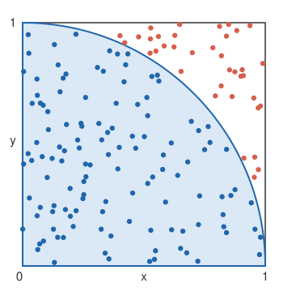

## What you will be able to do

:::{.nonincremental}
Make real code faster, and **prove what the whole program gained**:

1. **Measure** before optimizing.
2. **Split** the work, share as little as possible.
3. **Move less data**, in memory and to the GPU.
:::

. . .

> This is the [project](../exam.qmd).

::: {.notes}
Start from the project: every session delivers one piece of it. Session 1: a valid measurement
and a block to target. Session 2: a split and its reduction. Session 3: a decision about memory,
batch and GPU, checked on the whole program.
:::

## Three sessions of three hours {#sessions}

:::{.nonincremental}
| | theme | decks | activities |
|---|---|---|---|
| **1** | **Measure** | [0](0_julia_basics.qmd) · [1](1_compilation_and_types.qmd) · [2](2_dispatch_vs_oop.qmd) | loop cost · diagnosis |
| **2** | **Split** | [3](3_threads_and_concurrency.qmd) | waits · race · π in lots |
| **3** | **Move less** | [4](4_memory_and_batching.qmd) · [5](5_gpu.qmd) · [synthesis](#synthesis) | locality · batching · π on the card |
:::

. . .

> [Timed plan](../sessions.qmd): two 10-minute breaks per session.

::: {.notes}
0: just enough Julia to read the running example. 1: first call vs steady state, the measurement
card, local vs whole-program gain. 2: why the same source can cost 10–100× (types known or not).
3: overlap waits, split computing, the race, return-and-reduce, Amdahl.
4: latency vs throughput, locality, batching. 5: the bus, synchronization, small vs large work.
:::

## One running example

:::: {.columns}
::: {.column width="38%"}
{width="100%"}
:::
::: {.column width="62%"}
**Monte-Carlo π**: draw points, count those in the quarter disk, multiply by 4.

- Session 1: a **loop**, timed.
- Session 2: **split** over workers.
- Session 3: on the **GPU**.
:::
::::

::: {.notes}
One count, asked three times: how long does it take, who shares what, where does the data live?
:::

## How we work

:::{.nonincremental}
- Every experiment: **predict → run → explain**.
- Slides frame, demos show, **you measure** in the activities (20–30 min).
- **Python** is the common track; **Julia** is the test bench, optional for you.
:::

. . .

::: {.callout-note}
Every number comes with its **card**. We compare **ratios on the same machine**.
:::

::: {.notes}
Students write their prediction down before running. The card: result checked · input · machine · repetitions ·
what the timer includes (deck 1). The introduction starts from π; later decks open with "today's path". "Only if time" slides
sit at the end of the deck.
An explained slowdown is a valid result, in the activities and in the project.
Numbers on the slides are observations from one laptop, not targets to reproduce.
Each module also has a Julia script and Pluto notebook (reference), and a Python notebook.
:::

## Start here

:::{.nonincremental}
- ▶ [0 — Julia for Python users](0_julia_basics.qmd) — 15 minutes, then the first measurement.
- 📓 All scripts, notebooks and activities: [course page](../index.qmd).
:::

. . .

> **Next:** [0 — Julia for Python users](0_julia_basics.qmd) ➡

# Synthesis {#synthesis style="text-align: center;"}

## Five decisions, in this order {#decisions}

:::{.nonincremental}
1. **Check and measure**: a verified result, a number with its card.
2. **Find the dominant cost**: interpreter, waiting, memory, transfers?
3. **Split without sharing**: pieces return, reduce once.
4. **Move less data**: contiguous access, reuse, stay on the card.
5. **Verify the whole-program gain**, not just the block.
:::

. . .

> **Know where the time goes, then test your explanation.**

::: {.notes}
1: session 1 (card, tolerance for a random result). 2: the diagnosis activity, the decision table of session 2.
3: race → return and reduce. 4: locality, batching, the bus. 5: Amdahl, and the project's two
timings. Compilation and types are one answer to decision 2 ("the interpreter is the cost"),
not the headline of the course.
:::

## Transfer: three cases, no code {#transfer .smaller}

. . .

For each: **which optimization, why, and the next measurement?**

1. A script downloads 500 small files, then parses them. Parsing: 5 % of the time.
2. A pure-Python double loop computes pairwise distances: 95 % of the time.
3. A GPU scores requests one at a time; 200 requests arrive per second.

. . .

> Name the **result to preserve**, the **dominant cost**, and which measurement **could prove you wrong**.

::: {.notes}
10 minutes, on paper.
1: waiting dominates → overlap the downloads; speeding up parsing caps at 1.05×. Next: time
until all results are available, for a few worker counts.
2: the interpreter dominates → vectorize or compile first; only then consider processes. Next:
whole-program time, output compared with a tolerance.
3: the card is mostly idle at B = 1 → batch; but a larger lot makes each request wait. Next:
throughput and per-request latency for a few B.
:::

## A possible project: repeated predictions

. . .

**Illustrative figures**, not measurements from the course:

- Initial job: **10 s**, including **8 s** for one-by-one predictions.
- Hypothesis: batching reduces repeated loading of the model weights.
- Check: same predictions, within a justified numerical tolerance.
- If predictions fall to **2 s**: block gain **4×**, whole job **2.5×** (10 → 4 s).

::: {.notes}
Ask what to measure before implementing: a representative input, the initial total and block
times, resources and output check. Then ask what could invalidate the predicted gain:
batch assembly, output concatenation, memory limits or request waiting time. Measure those
costs in the whole job. A well-explained smaller gain is a useful project result.
:::

## From the course to your project

:::{.nonincremental}
- **Before you start, check with me:** result to preserve · first whole-program timing · target block · hypothesis.
- **Report:** block gain **and** whole-program gain, each with its card.
- An explained **slowdown** is a valid finding.
:::

. . .

> Before leaving, each group writes **one timing and one hypothesis**.

. . .

> ⬅ [5 — GPU](5_gpu.qmd)  ·  [Course page](../index.qmd)  ·  [Project rules](../exam.qmd)

::: {.notes}
Grading: correctness, protocol and reproducibility, diagnosis, report and talk, 25 % each. Use the session-1 exit tickets (candidate blocks) to start the discussion.
:::
